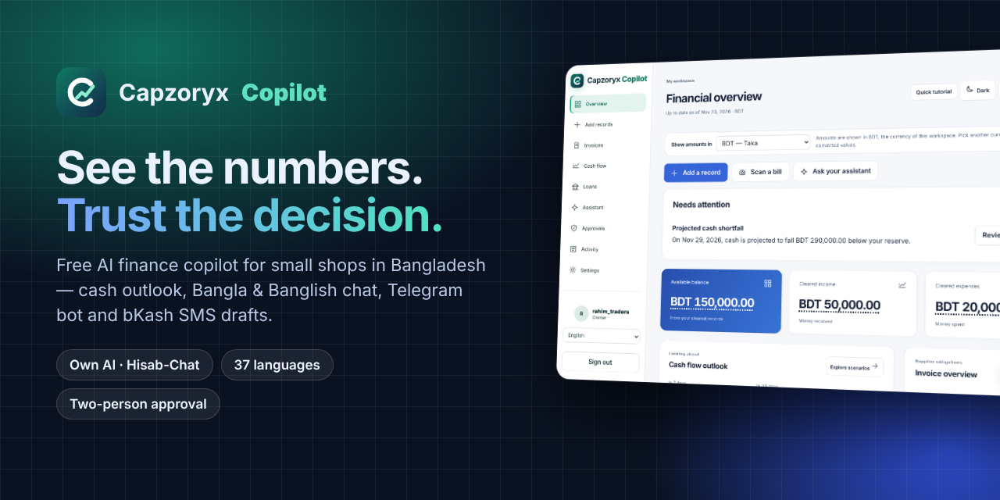
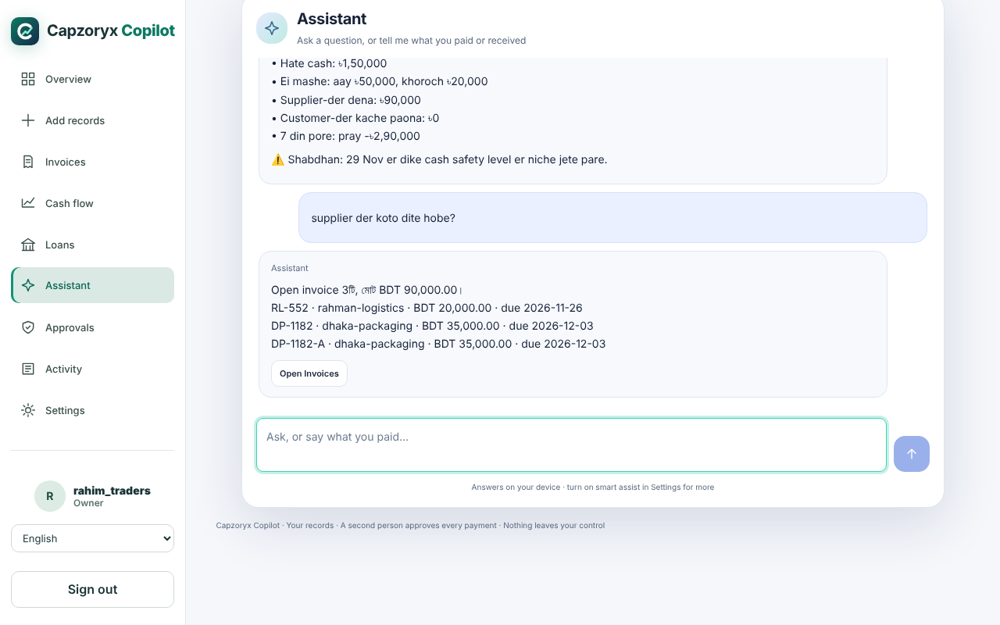
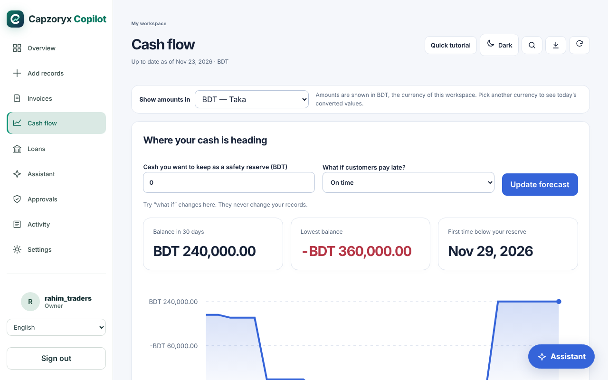
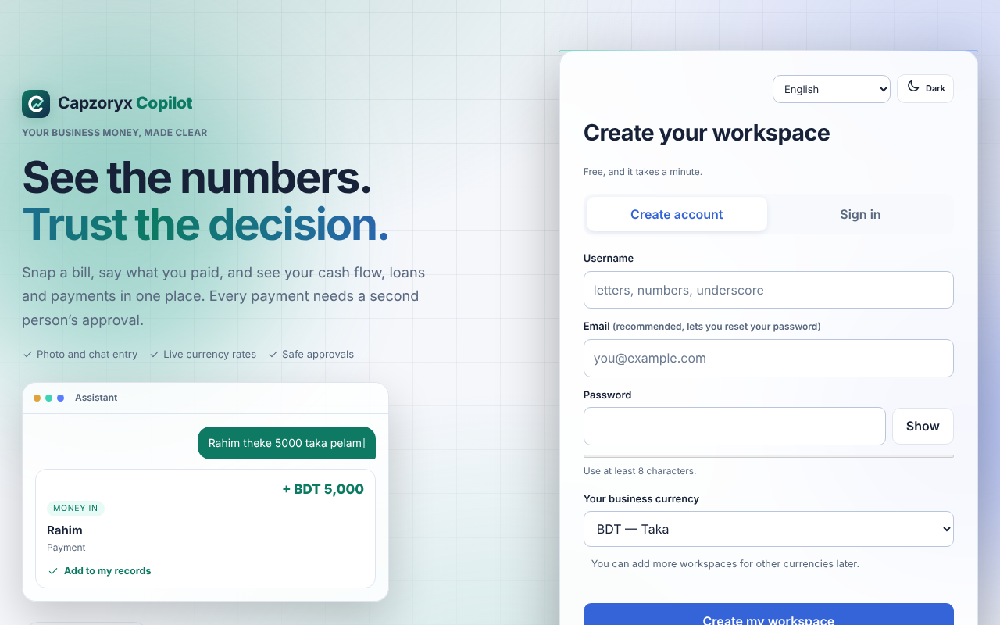
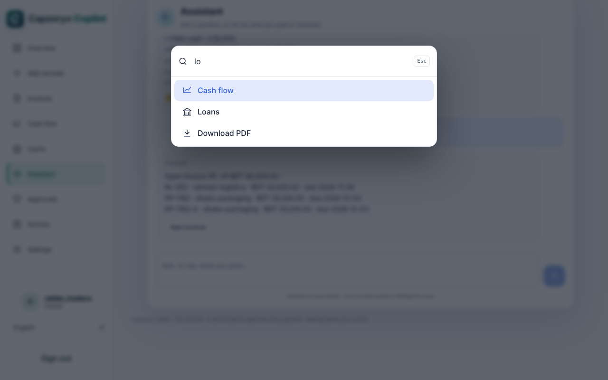
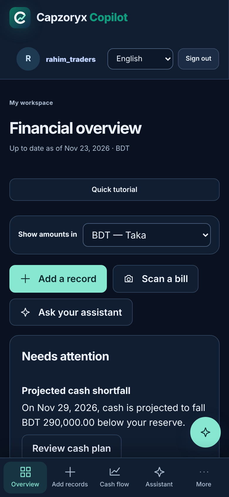
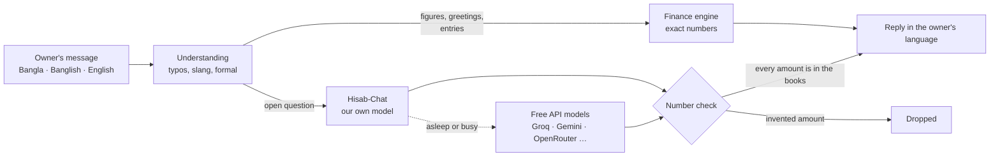
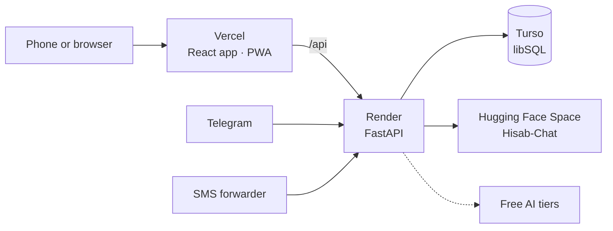

<p align="center">
  
</p>

<h1 align="center">Capzoryx Copilot</h1>

<p align="center"><b>See the numbers. Trust the decision.</b><br>
A free AI finance copilot for small shops in Bangladesh. It tells an owner whether there will be enough cash when the
next bill is due, answers in Bangla, Banglish or English like a person would, and never moves money.</p>

<p align="center">
  <a href="https://capzoryx-competition.onrender.com/demo"><b>Live judge demo</b></a> &nbsp;·&nbsp;
  <a href="https://capzoryx-competition.onrender.com/"><b>Open the workspace</b></a> &nbsp;·&nbsp;
  <a href="https://t.me/CapzoryxBot"><b>Chat on Telegram</b></a> &nbsp;·&nbsp;
  <a href="docs/DEMO.md">Demo walkthrough</a> &nbsp;·&nbsp;
  <a href="docs/INDEX.md">Documentation</a>
</p>

<p align="center">
  <a href="https://github.com/Pranto-404/Capzoryx/actions/workflows/ci.yml"></a>
  
  
  
</p>

<p align="center"></p>

Built by **Team Capzoryx** · project start **21 November 2026**.

### Submission files

| File | What it is |
|---|---|
| [`project.pdf`](project.pdf) | The idea document submitted to the CoU Technova AI Hackathon 2026 |
| [`LICENSE`](LICENSE) | The hackathon's judging licence for this submission repository |
| [`LICENSE-CODE`](LICENSE-CODE) | The MIT licence of the Capzoryx source code |
| [`docs/COMPETITION.md`](docs/COMPETITION.md) | The two competition challenges, how they are solved, and the demo script |

Development history is kept in full; the production repository is
[Pranto-404/Capzoryx](https://github.com/Pranto-404/Capzoryx) (`main`), and this repository's `master` is the frozen
submission.

## Competition walkthrough

| Task | Try it live | What to verify |
| --- | --- | --- |
| **One week of spending from one voice note** | On the [judge demo](https://capzoryx-competition.onrender.com/demo), choose **Seven-day spending sample**, then **Make drafts**. | Seven dated drafts with **Tk 21,950** in spending. Edit an amount or exclude a draft before confirming the preview. |
| **Cash Radar for late customer payments** | On the same page, switch between **Customer usually pays late** and **Overdue payment may still arrive**. | The first case is an **Alert** for **Tk 20,000 below reserve**. The second is a **Watch**. Compare recorded cash, the expected collection forecast and the stress case. |

The public demo uses fictional records. To record your own voice note, open a workspace, enable **Settings → Smart assist** and choose **Add records → Voice note**. You can replay the recording, request a second transcription, edit the text, review each draft and save the selected records together. [Competition brief and verification](docs/COMPETITION.md)

For a voice conversation, open **Assistant → Talk to Capzoryx**, record a turn and press **Stop**. Ask about balances or invoices, or describe money that moved to preview drafts. Available speech models transcribe the same audio and Capzoryx compares the transaction amounts and dates it can verify. You can correct the transcript, and selected entries are saved only after you confirm them. Spoken replies use the device's installed voices.

## Why it is different

- **It talks like a person.** "cash kto ase vai?", "হাতে কত টাকা আছে?", "Kindly share my cash position" all get a
  natural reply in the same language, with follow-ups ("ar goto mashe?"), summaries and who-owes-whom lists.
- **Check the numbers.** Workspace balances and forecasts come from a deterministic engine that uses integer minor units.
  The assistant validates amounts in model-generated replies against its financial context.
- **Our own AI, trained to be trustworthy.** Hisab-Chat is fine-tuned on synthetic Bangla, Banglish and English
  conversations, then quizzed, graded and corrected by larger teacher models in self-play rounds.
- **It works where shops already are.** A Telegram bot, bKash/Nagad/bank SMS turned into one-tap drafts, offline entry
  on cheap phones, voice and bill photos read on the device.
- **People decide.** Every draft is shown before saving. A separate approver reviews payments when one is assigned.
  A solo owner can record a reviewed payment. Both paths leave a signed audit trail.
- **Free to run.** Vercel, Render, Turso, Hugging Face and free AI tiers, with daily budgets that keep quotas safe.

<p align="center">
  
  
</p>
<p align="center">
  
  
</p>

## What it does

| Area | What the owner gets |
| --- | --- |
| **Overview** | Cash in hand, money in and out, open bills, a shortfall warning with the date, and a plan to close the gap. |
| **Add records** | Type or say "Rahim theke 5000 taka pelam", photograph a bill or a khata page, or fill in a form. Every draft is checked before saving; offline entries sync later. |
| **Cash flow** | Deterministic 7- and 30-day outlook with a safety reserve, what-if scenarios and an early-collection planner. |
| **Assistant** | Bangla, Banglish and English questions answered from the books: balance, sales, spending, dues, bills, forecast, summary. |
| **Telegram bot** | One-tap connect from Settings. Ask anything, get a morning summary, save cash entries with a Save button. |
| **Payment SMS** | Forward bKash, Nagad, Rocket and bank SMS from an Android phone; each payment becomes a draft with Save or Skip. OTP and PIN messages are dropped. |
| **Receivables** | Customer dues, collection estimates and polite reminders the owner sends. |
| **Loans** | Real offers compared on effective annual cost against the business's own cash flow. |
| **Approvals and activity** | Review payments as a solo owner or assign a separate approver. See the signed activity history. |
| **Cash-flow passport** | A signed, expiring summary a lender can verify by QR, revocable at any time. |
| **Everywhere** | 37 interface languages (right-to-left included), 150+ currencies, installable web app, Android build, light and dark themes, Ctrl+K quick jump. |

<p align="center"></p>

## How the AI works



Training Hisab-Chat (`ml/hisab_chat/`):

1. **Data**: 5,400+ distinct owner questions, rewritten the way people type (typos, "kto"/"kmn", capitals, "vai",
   formal phrasing), with answers from Capzoryx's templates and from teacher models. Every answer passes the number and
   language checks.
2. **Training**: LoRA fine-tune of Qwen3-4B on one consumer GPU or a free Kaggle GPU (one notebook cell).
3. **Self-play**: teacher models write new questions in twelve styles, grade Hisab-Chat from 1 to 5 and rewrite weak
   answers; the corrections become the next round's training data. Each round reports its mean score.
4. **Serving**: the quantised model runs on a free Hugging Face Space; the bot asks it first.

## Architecture



- **Frontend**: React 19, TypeScript and Vite on Vercel; strict CSP with no inline script or style; service worker for
  offline entry. `/api` is rewritten to the backend.
- **Backend**: FastAPI on Render; Turso (libSQL over HTTPS) in production, SQLite locally.
- **Money**: integer minor units, append-only postings, independent approval, signed and checkpointed audit chain.
- **Privacy**: customer names, phones, chat links, chat memory and SMS drafts are sealed with a per-workspace key.
- **Accounts**: scrypt password hashes, HttpOnly sessions, TOTP two-step sign-in, recovery codes, roles.

## Run it locally

Python 3.12 and Node.js 22 or newer, from the repository root:

```bash
python -m venv .venv && source .venv/bin/activate
python -m pip install -r api/requirements.lock.txt
cp .env.example .env
python -c 'import secrets; print("SAFELEDGER_SIGNING_KEY=" + secrets.token_hex(32))' >> .env
set -a && source .env && set +a
python -m uvicorn api.app.main:app --host 127.0.0.1 --port 8000
```

In a second terminal:

```bash
npm ci --prefix web
npm run dev --prefix web
```

Open http://127.0.0.1:5173, create an account and choose **Try a sample business**. Keep the signing key across
restarts; no cloud service is needed for the books, the assistant's figures or the forecasts.

## Configuration

Set these on the backend (Render). `.env.example` lists every option.

| Variable | Purpose |
| --- | --- |
| `SAFELEDGER_SIGNING_KEY` | 64-hex key for signatures and sealed data. Required; never rotate casually. |
| `TURSO_DATABASE_URL`, `TURSO_AUTH_TOKEN` | Production database. |
| `SAFELEDGER_PUBLIC_URL`, `SAFELEDGER_CORS_ORIGINS` | Public site address and allowed origins. |
| `SAFELEDGER_TELEGRAM_ENABLED`, `_BOT_TOKEN`, `_BOT_USERNAME`, `_WEBHOOK_SECRET`, `_WEBHOOK_URL` | Telegram bot ([guide](docs/TELEGRAM.md)). |
| `CAPZORYX_CHAT_HISAB_URL`, `CAPZORYX_CHAT_HISAB_KEY` | Hisab-Chat on its Hugging Face Space. |
| `CAPZORYX_CHAT_GROQ_KEY`, `_GEMINI_KEY`, `_CEREBRAS_KEY`, `_OPENROUTER_KEY`, `_MISTRAL_KEY`, `_GITHUB_KEY`, `_SAMBANOVA_KEY` | Optional free AI fallbacks for open conversation, tried in this order after the own model. The first one that answers also rewrites the own model's replies into one voice (`CAPZORYX_CHAT_POLISH=0` turns that off). See docs/AI_KEYS.md. |
| `SAFELEDGER_MAIL_RELAY_URL`, `SAFELEDGER_MAIL_RELAY_SECRET`, `SAFELEDGER_MAIL_FROM` | Email codes and bill reminders ([guide](docs/EMAIL-REMINDERS.md)). |
| `SAFELEDGER_VAPID_*`, `SAFELEDGER_FCM_SERVICE_ACCOUNT_JSON` | Web and Android push ([guide](docs/PUSH.md)). |
| `CAPZORYX_TICK_SECRET` | Signed scheduler calls for reminders. |
| `SAFELEDGER_READ_ONLY` | Emergency read-only switch ([incident runbook](docs/INCIDENT.md)). |

## Project layout

```text
api/app/            FastAPI service: accounts, ledger, forecasts, receivables, passport
api/app/chat/       conversation brain, free-first model chain, in-app chat
api/app/notifications/  Telegram bot, payment SMS inbox, email, push, scheduler
api/tests/          Backend unit and integration tests
web/src/            React app (website, installable PWA and Android share one codebase)
web/android/        Capacitor Android project
ml/hisab_chat/      Hisab-Chat data, training, self-play, evaluation, Space and Kaggle runner
ml/hisab_lm/, ml/tagger/  earlier cash-draft model and on-device tagger
docs/               guides, runbooks and the UX audit
```

## Quality

- `python -m pytest api/tests -q`: Covers money invariants, roles, the Telegram and SMS flows, the chat
  brain on misspelt, slang and formal messages, and the model chain's number check.
- `npm run build --prefix web` and `npm test --prefix web`: type-checked build and browser-side finance fixtures.
- `node scripts/check_rahim_browser.cjs`: a real browser signs up, records cash, plans a collection, issues and
  revokes a passport, and saves only after confirmation.
- CI runs all of these on every pull request, plus dependency audits and a secret scan.

## Security

Read [SECURITY.md](SECURITY.md) for data handling and how to report a problem. Never enter bank passwords, PINs or
OTPs into the app or the bot; Capzoryx never asks for them.

## Contributing

See [CONTRIBUTING.md](CONTRIBUTING.md). Documentation lives in [docs/INDEX.md](docs/INDEX.md).

## License

Source code: [MIT](LICENSE-CODE) © 2026 Team Capzoryx. This submission repository is also covered by the
hackathon's judging licence in [LICENSE](LICENSE).
